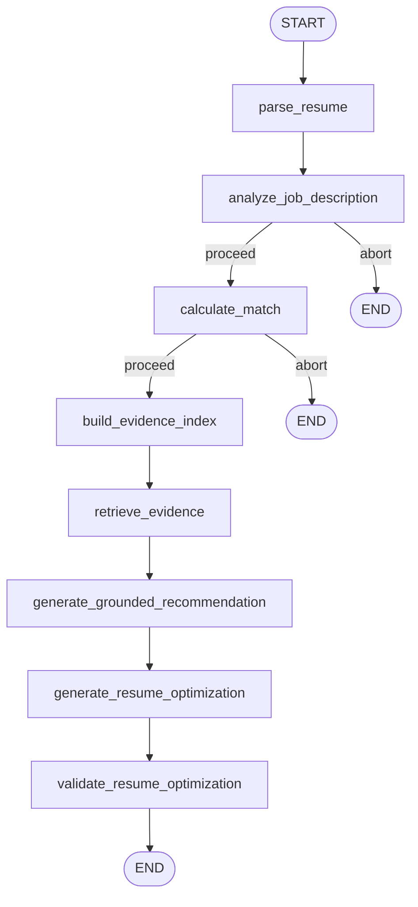

# CareerPilot

**Evidence-grounded AI job-fit analysis and resume optimization.**

CareerPilot takes a resume and a job description, extracts structured profiles with an LLM, computes a deterministic weighted match score, retrieves verbatim resume evidence for every claim, and generates resume optimization suggestions that are validated against a nine-check factual boundary. Nothing in the output can invent facts the candidate didn't write.

---

## Key Features

- **PDF resume upload** with text extraction via pdfplumber
- **LLM-powered extraction** of candidate profiles and job requirements (structured Pydantic models, not free text)
- **Deterministic weighted scoring** — five rubric components with fixed weights, no LLM involvement, identical inputs always produce identical scores
- **Evidence retrieval** — hybrid lexical + cosine matching that traces every claim back to verbatim resume chunks
- **Evidence-constrained optimization** — rewrite, reorder, and surface suggestions that cite specific evidence IDs and pass nine post-generation validation checks
- **Bilingual support** — Chinese and English resumes, skill aliases, section headers, education normalization, and factual concept validation
- **Mock provider** — fully offline operation with no API key required; swap to DeepSeek, OpenAI, or Qwen with a single env var
- **206 tests** including adversarial Chinese factuality cases, all passing with zero external dependencies

---

## Architecture



The pipeline is orchestrated by **LangGraph**. Each node is a pure function over a shared `AnalysisState` TypedDict:

| Node | Role | LLM? |
|---|---|---|
| `parse_resume` | Extract `CandidateProfile` from raw resume text | Yes |
| `analyze_job_description` | Extract `JobRequirements` from JD text | Yes |
| `calculate_match` | Deterministic weighted scoring (no LLM) | No |
| `build_evidence_index` | Chunk resume into `ResumeEvidence` items, embed, and index | No |
| `retrieve_evidence` | For each claim, retrieve and classify evidence as supported / partially_supported / unsupported | No |
| `generate_grounded_recommendation` | LLM narrative grounded in retrieved evidence | Yes |
| `generate_resume_optimization` | Evidence-cited rewrite/reorder/surface suggestions | Yes |
| `validate_resume_optimization` | Nine-check deterministic validator (no LLM) | No |

Conditional edges abort early when extraction or matching produces incomplete results.

---

## Why Hybrid LLM + Deterministic

Pure LLM scoring is non-reproducible: the same resume can produce different scores across runs. Pure rule-based systems can't parse free-text resumes.

CareerPilot assigns each technology to what it does best:

| Task | Technology | Why |
|---|---|---|
| Resume/JD parsing | LLM | Free-text extraction from unstructured documents |
| Skill matching | Deterministic | Normalized alias resolution, group satisfaction logic |
| Scoring | Deterministic | Fixed weights, no randomness, fully auditable |
| Evidence retrieval | Deterministic | Cosine similarity for ranking, lexical checks for classification |
| Narrative generation | LLM | Natural language grounded in retrieved evidence |
| Optimization validation | Deterministic | Nine checks that reject any action introducing unverified facts |

The match score is **never** modified by the LLM. The optimizer can suggest changes but cannot alter the score. This separation means recruiters can trust the score as an objective measure while still getting actionable optimization advice.

---

## Evidence-Constrained Resume Optimization

The optimizer generates three types of actions — `rewrite`, `surface_existing_evidence`, and `reorder` — each of which must cite specific `ResumeEvidence` IDs. A deterministic `OptimizationValidator` runs nine checks (A–I) on every action before it reaches the user:

| Check | Field | What it prevents |
|---|---|---|
| A | `action_type` | `gap_warning` appearing in the actions array instead of `gap_warnings` |
| B | `evidence_ids` | Citing evidence IDs that don't exist |
| C | `evidence_ids`, `optimized_text`, `original_text` | Structurally incomplete actions (missing text, missing citations) |
| D | `target_requirements` | Rewriting bullets for requirements the candidate has zero evidence for |
| E | `optimized_text` | Inventing numbers not found in cited evidence |
| F | `optimized_text` | Introducing skills not found in cited evidence |
| G | `optimized_text` | Fabricating employment years not in cited evidence (experience section) |
| H | `unsupported_concept` | Introducing factual concepts (deployment, optimization, troubleshooting, etc.) not present in cited evidence — bilingual Chinese+English |
| I | `cross_scope_evidence` | Merging facts from unrelated resume entries (e.g., combining Job A and Job B into one bullet) |

Invalid actions are dropped and recorded as `ValidationIssue` entries so the rest of the optimization result remains usable. The validator is evidence-scoped: support comes only from the action's cited evidence IDs, not the entire resume.

---

## Multilingual Support

CareerPilot handles Chinese and English resumes with the same pipeline. No language detection step — both languages are processed in parallel at every layer:

- **Section headers**: Chinese headers (工作经历, 教育背景, 专业技能, 项目经历, 自我评价) are recognized by the resume chunker
- **Skill aliases**: 150+ Chinese↔English skill mappings (传感器↔sensor, 激光雷达↔lidar, 工业机器人↔robotics, etc.) resolved deterministically before matching
- **Education normalization**: Chinese degree names (学士, 硕士, 博士) mapped to a common level scale alongside English equivalents
- **Domain families**: Chinese domain signals (工业自动化, 智能制造, 数据采集) normalized to canonical families
- **Factual concepts**: 50+ bilingual activity concepts (部署↔deployment, 稳定性优化↔stability_optimization, 故障排查↔troubleshooting, etc.) used by validation check H
- **CJK text handling**: Dedicated `contains_cjk` detection, CJK-aware token overlap for evidence classification (no `\b` word boundaries)

---

## Tech Stack

| Layer | Technology |
|---|---|
| Backend framework | FastAPI 0.110+ |
| Data validation | Pydantic 2.6+, pydantic-settings |
| Pipeline orchestration | LangGraph 0.2+ |
| LLM providers | OpenAI-compatible API (OpenAI, DeepSeek, Qwen) + offline mock |
| PDF extraction | pdfplumber 0.11+ |
| Embeddings | numpy-based cosine similarity, in-memory vector store |
| Frontend | React 18, Vite 5 |
| Testing | pytest 8+, httpx |

---

## Testing

```bash
# Run all 206 tests (fully offline, no API key needed)
cd backend
pytest tests/ -q

# Run evaluation scripts against sample data
python scripts/evaluate_evidence.py          # Evidence retrieval quality
python scripts/evaluate_optimization.py      # Optimization validation
python scripts/evaluate_real_matching.py     # Real-world matching accuracy
python scripts/evaluate_chinese_optimization.py  # Chinese optimization validation
```

**Test coverage spans:**

- Schema validation and edge cases
- Skill normalization (aliases, compound skills, OR/AND groups, unmapped terms)
- Domain and education normalization
- Matching scorer (all five components, diagnostics)
- Evidence chunking, embedding, vector store, and retrieval
- LangGraph workflow (full pipeline, conditional routing, abort paths)
- Optimization (policy, optimizer, all nine validator checks A–I)
- LLM providers (mock, OpenAI-compatible, registry)
- API routes (upload, analysis, error handling)
- Chinese resume regression (full pipeline with Chinese fixture)
- Multilingual factuality (adversarial Chinese concept injection, cross-role provenance)
- PDF extraction

---

## Real Chinese Resume Acceptance

The pipeline has been validated against real Chinese production resumes with the following acceptance criteria:

- `CandidateProfile` extraction: name, email, phone, skills, experience entries, education — all correctly parsed from Chinese section headers
- Match scoring: deterministic weights produce consistent scores across runs
- Evidence retrieval: every matched skill traces to a verbatim Chinese resume chunk
- Optimization: all accepted actions pass checks A–I, including bilingual factual concept validation (check H) and cross-role provenance guard (check I)
- Zero fabricated facts in any accepted optimization action

---

## Quick Start

### Prerequisites

- Python 3.11+
- Node.js 18+

### Backend

```bash
cd backend

# Create a virtual environment
python -m venv .venv
source .venv/bin/activate   # Windows: .venv\Scripts\activate

# Install dependencies
pip install -r requirements-dev.txt

# Copy and configure environment (defaults to mock provider — no API key needed)
cp .env.example .env

# Start the API server
uvicorn app.main:app --reload --port 8000
```

### Frontend

```bash
cd frontend

# Install dependencies
npm install

# Start the dev server (proxies /api to localhost:8000)
npm run dev
```

Open `http://localhost:5173`, upload a PDF resume, paste a job description, and click **Analyze Match**.

### Using a real LLM provider

Edit `backend/.env`:

```env
LLM_PROVIDER=deepseek          # or openai, qwen
LLM_API_KEY=your-api-key
LLM_MODEL=deepseek-chat        # optional, defaults per provider
LLM_BASE_URL=                  # optional, defaults per provider
```

Supported providers and their defaults:

| Provider | Default model | Default base URL |
|---|---|---|
| `mock` | _(none)_ | _(none — fully offline)_ |
| `openai` | `gpt-4o-mini` | `https://api.openai.com/v1` |
| `deepseek` | `deepseek-chat` | `https://api.deepseek.com` |
| `qwen` | `qwen-plus` | `https://dashscope.aliyuncs.com/compatible-mode/v1` |

---

## Docker Quick Start

Run the entire stack with one command. No Python, Node, or dependency installation needed.

### Prerequisites

- Docker Desktop (or Docker Engine + Docker Compose v2)

### Mock mode (default, no API key)

```bash
git clone <repo>
cd careerpilot
cp backend/.env.example backend/.env
docker compose up --build
```

Open **http://localhost** in your browser.

- Frontend: nginx serving the Vite production build on port 80
- Backend: FastAPI on internal port 8000, reverse-proxied through nginx at `/api/*`
- LLM: mock provider (fully offline, deterministic heuristics)

### Optional DeepSeek mode

Edit `backend/.env` before running `docker compose up`:

```env
LLM_PROVIDER=deepseek
LLM_API_KEY=your-api-key-here
```

Then rebuild and start:

```bash
docker compose up --build
```

### Commands

```bash
# Start (attached)
docker compose up

# Start (detached)
docker compose up -d

# Stop
docker compose down

# Rebuild after code changes
docker compose up --build
```

### Ports

| Service | Host port | Internal port | URL |
|---|---|---|---|
| Frontend (nginx) | 80 | 80 | http://localhost |
| Backend (FastAPI) | — | 8000 | via nginx at /api/* |

The backend is not exposed to the host — all browser requests go through nginx.

---

## Render Deployment

CareerPilot ships as a single-container image for Render Web Service deployment. The container combines nginx (React SPA + reverse proxy) with uvicorn (FastAPI backend) in one process, requiring no external services or API keys.

### Architecture

```
Render Web Service (single container)
├── nginx (port $PORT from Render)
│   ├── Serves React SPA at /
│   ├── Proxies /api/* to uvicorn at 127.0.0.1:8000
│   └── Rate limits /api/analysis/ to 5 req/min/IP
└── uvicorn (127.0.0.1:8000, internal only)
    └── FastAPI with mock LLM provider
```

### Build and run locally

```bash
docker build -t careerpilot-render -f Dockerfile.render .
docker run -p 8080:8080 -e PORT=8080 -e APP_ENV=production -e LLM_PROVIDER=mock careerpilot-render
```

Open **http://localhost:8080**.

### Deploy to Render

The included `render.yaml` blueprint defines a single web service:

```yaml
services:
  - type: web
    name: careerpilot
    runtime: docker
    dockerfilePath: Dockerfile.render
    dockerContext: .
    healthCheckPath: /api/health
    envVars:
      - key: APP_ENV
        value: production
      - key: LLM_PROVIDER
        value: mock
```

To deploy: push the repository to GitHub, connect it in the Render dashboard, and Render will auto-detect `render.yaml`. No additional configuration needed.

### Production hardening

When `APP_ENV=production`:

- FastAPI `/docs`, `/redoc`, and `/openapi.json` endpoints are disabled
- nginx hides its version number (`server_tokens off`)
- `/api/analysis/` is rate-limited to 5 requests/minute per IP (burst 2)
- PDF uploads validate magic bytes before processing
- Input text fields are capped at 50,000 characters
- `.env` files, PII data, and test fixtures are excluded from the Docker image via `.dockerignore`

---

## Project Structure

```
careerpilot/
├── backend/
│   ├── app/
│   │   ├── api/routes/          # FastAPI endpoints (resumes, analysis)
│   │   ├── core/                # Settings (pydantic-settings)
│   │   ├── models/              # Pydantic schemas (CandidateProfile, MatchResult, etc.)
│   │   ├── prompts/             # LLM prompt templates
│   │   └── services/
│   │       ├── evidence/        # Chunking, embeddings, vector store, retrieval
│   │       ├── graph/           # LangGraph nodes, state, workflow
│   │       ├── llm/             # Provider base, mock, OpenAI-compatible
│   │       └── optimization/    # Optimizer, policy, validator
│   ├── scripts/                 # Evaluation and audit scripts
│   ├── tests/                   # 206 pytest tests
│   ├── Dockerfile
│   ├── requirements.txt
│   └── .env.example
├── frontend/
│   ├── src/
│   │   ├── api/                 # HTTP client
│   │   ├── components/          # ResumeUpload, JobDescriptionInput, MatchResults
│   │   ├── App.jsx
│   │   └── styles.css
│   ├── Dockerfile
│   ├── nginx.conf
│   ├── index.html
│   └── vite.config.js
├── Dockerfile.render            # Single-container image for Render
├── nginx.render.conf.template   # nginx config with $PORT envsubst
├── start.sh                     # Container entrypoint (uvicorn + nginx)
├── docker-compose.yml           # Local two-container dev stack
├── render.yaml                  # Render Blueprint
└── README.md
```

---

## Design Decisions

1. **Score immutability**: The `MatchResult` is computed before the optimizer runs and is never passed to the optimization LLM. The optimizer can suggest changes but cannot alter the score. This is enforced structurally, not by convention.

2. **Evidence-scoped validation**: Check H validates against the action's cited `evidence_ids`, not the entire resume. A concept that exists elsewhere in the resume but wasn't cited is still rejected — the optimizer must explicitly cite its sources.

3. **Original-text subtraction**: When a rewrite retains a concept from the original bullet, check H does not flag it. Only *new* concepts introduced by the optimization are checked against evidence.

4. **Mock-first development**: The mock LLM provider uses deterministic heuristics (regex, keyword matching) to produce structured output without any API calls. This means the full pipeline runs in tests with zero external dependencies and zero cost.

5. **Longest-first alias matching**: Both skill normalization and factual concept extraction sort aliases by `(-len(alias), alias)` so that `模型部署` matches before `部署`, and `system integration` matches before `integration`. This prevents partial matches from shadowing compound terms.

6. **No language detection**: Instead of detecting the resume language and branching, every normalization layer (skills, domains, education, concepts) includes both Chinese and English aliases. The same code path handles both languages.

7. **Conditional pipeline abort**: If extraction fails (no skills, no experience) or matching produces an invalid score, the graph aborts before evidence retrieval. This prevents downstream nodes from operating on empty or corrupt state.

---

## Known Limitations

- **Single-page PDFs**: pdfplumber extracts text from all pages, but the chunker has no page-boundary awareness — a two-page resume is treated as one continuous document
- **No OCR**: Scanned/image-based PDFs are not supported; only text-layer PDFs
- **No authentication**: The API has no user auth — intended for local development use
- **No persistence**: All state is in-memory; uploaded resumes and analysis results are lost on server restart
- **No batch processing**: One resume + one JD per request
- **Embedding quality**: The mock embedding provider uses hash-based vectors; real semantic similarity requires configuring an embedding API
- **Token overlap for non-skill claims**: Responsibility and strength evidence classification uses token overlap ratios, which can misclassify long or abstract claims
- **No ATS format output**: Optimization suggestions are text-based; no formatted document generation

---

## Security

- **API keys**: Stored in `backend/.env`, which is excluded by `.gitignore` and `.dockerignore`. A `.env.example` with mock defaults is committed instead. Never commit real API keys.
- **CORS**: Restricted to `http://localhost:5173` and `http://127.0.0.1:5173` by default. Configure via `CORS_ORIGINS` env var.
- **Upload size**: Capped at 10 MB (configurable via `MAX_UPLOAD_SIZE_MB`).
- **PDF validation**: Upload endpoint checks for `%PDF-` magic bytes before processing, rejecting non-PDF files with HTTP 415.
- **Input limits**: `resume_text` and `job_description` fields capped at 50,000 characters each via Pydantic validation.
- **Rate limiting**: `/api/analysis/` endpoint limited to 5 requests/minute per IP with burst of 2 (nginx `limit_req`).
- **Production mode**: Set `APP_ENV=production` to disable FastAPI `/docs`, `/redoc`, and `/openapi.json` endpoints.
- **PII**: Real resume samples used for evaluation (`scripts/prod_raw_text.txt`, `scripts/prod_response.json`) contain personal data and are excluded by `.gitignore` and `.dockerignore`. Do not commit files containing real candidate PII.
- **Docker image hygiene**: `.dockerignore` excludes `.env` files (at any depth), PII data, test fixtures, and caches from the build context.
- **No data persistence**: Resumes are processed in memory and not stored to disk or a database.

---

## Project Behavior

CareerPilot Phases 1–4.1 are feature-frozen. The current implementation covers:

- Phase 1: FastAPI backend, React frontend, PDF upload, LLM extraction
- Phase 2: Deterministic matching scorer, LangGraph orchestration, score breakdown UI
- Phase 3: Skill normalization, evidence retrieval (chunking + embeddings + vector store + retrieval)
- Phase 3.1: Evidence-grounded LLM recommendations
- Phase 3.2: Matching diagnostics and real-world validation
- Phase 3.3: Domain normalization, education normalization, Chinese/English bilingual support
- Phase 4: Evidence-constrained resume optimization with post-generation validation (checks A–G)
- Phase 4.1: Multilingual factuality validation (checks H–I), bilingual concept extraction

No matching logic, scoring weights, evidence semantics, optimization behavior, or LLM behavior should be modified without re-running the full test suite and evaluation scripts.
